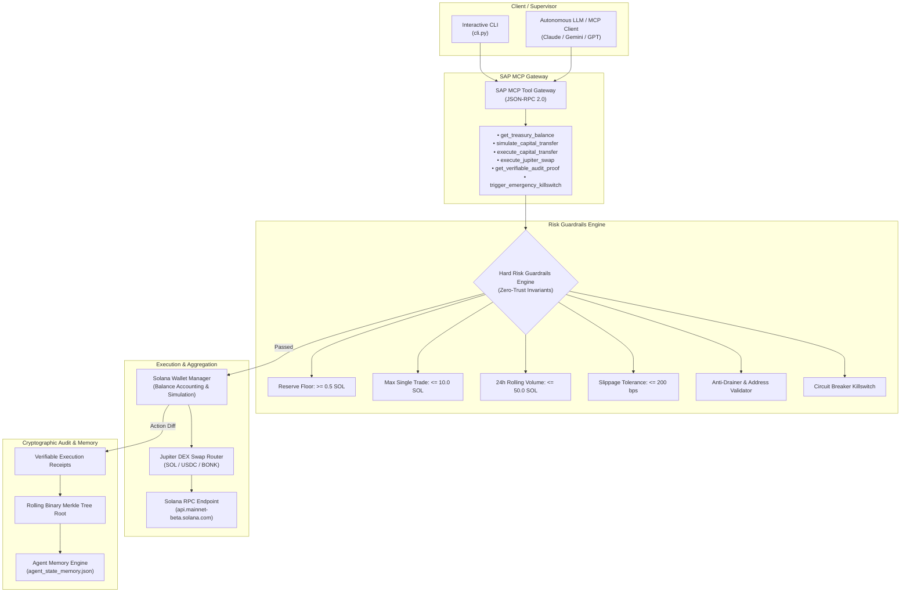

# 🦅 OOBE Autonomous Capital & Treasury Agent on Solana

> **Production-grade, verifiable autonomous capital management agent conforming to the OOBE Protocol and Solana Agent Protocol (SAP) / Model Context Protocol (MCP) specifications.**

---

## 📌 Executive Summary

The **OOBE Autonomous Capital Agent** is designed to manage on-chain Solana treasuries with deterministic safety guarantees, autonomous portfolio rebalancing, and verifiable cryptographic execution. 

Unlike conventional LLM-wrapped bots that execute unbounded actions, this agent enforces **hard, non-negotiable risk invariants directly in code**, guaranteeing that:
1. **The agent can never drain its gas reserves** (Reserve Floor Invariant).
2. **Single transactions cannot exceed bounded capital thresholds** (Max Single Trade Invariant).
3. **Cumulative volume across rolling 24-hour windows is strictly throttled** (Velocity Throttling Invariant).
4. **Transactions to malformed, blacklisted, or suspicious drainer addresses are aborted before signing** (Anti-Drainer Invariant).
5. **Every action generates an immutable execution receipt anchored in a rolling binary Merkle tree root hash** (Verifiable Execution Invariant).

---

## 🏗️ Architecture & Component Flow



---

## 🛡️ Core Safety Invariants

| Invariant | Threshold | Behavior Upon Breach |
| :--- | :--- | :--- |
| **Minimum SOL Reserve Floor** | `0.5 SOL` | Rejects any transfer or swap that leaves the agent vault below the minimum gas threshold. |
| **Max Single Trade Limit** | `10.0 SOL` | Automatically tranches large portfolio rebalancing orders or rejects manual transfers exceeding the cap. |
| **Rolling 24h Volume Cap** | `50.0 SOL` | Throttles high-frequency churn and prevents flash depletion. |
| **Max Slippage Tolerance** | `200 bps` (2.0%) | Aborts swaps if slippage exceeds acceptable parameters (default: 25-50 bps). |
| **Anti-Drainer Address Sanitizer** | Blacklist + Format | Blocks known drainers and malformed/non-base58 addresses. |
| **Circuit Breaker** | Binary Flag | Instantly suspends all transaction signing; requires operator intervention to reset. |

---

## 🛠️ Registered SAP Model Context Protocol (MCP) Tools

The agent exposes compliant Model Context Protocol tools for orchestrators (e.g. Claude Desktop, Cursor, Antigravity, AutoGPT):

1. **`get_treasury_balance`**
   - Retrieves real-time token balances (SOL, USDC, BONK), 24h rolling volume, and circuit breaker status.
2. **`simulate_capital_transfer`**
   - Performs a zero-broadcast simulation to verify compute unit consumption, fees, and guardrail validation.
3. **`execute_capital_transfer`**
   - Executes a verified on-chain transfer protected by risk invariants.
4. **`execute_jupiter_swap`**
   - Routes optimal token swaps via Jupiter DEX with slippage enforcement.
5. **`get_verifiable_audit_proof`**
   - Returns the current rolling Merkle root hash and cryptographic execution receipt sequence.
6. **`trigger_emergency_killswitch`**
   - Instantly halts all trading and state changes across the entire runtime.

---

## 🚀 Quickstart & Setup

### Prerequisites
- Python 3.10 or higher
- PowerShell 5.1+ / bash / zsh

### 1. Clone & Enter Directory
```bash
git clone https://github.com/ShayanMuhammad-CS/oobe-capital-agent.git
cd oobe-capital-agent
```

### 2. Run the Harsh Test Suite (26 Tests)
```bash
python -m unittest discover -s tests -p "test_*.py" -v
```

All 26 tests pass covering:
- Zero & negative trade rejection
- Single trade & reserve floor boundary enforcement
- Rolling 24h volume tracking
- Anti-drainer blacklist filtering
- Binary Merkle tree computation (odd/even leaf counts)
- Non-BOM UTF-8 JSON persistence (`RULE-16`)
- MCP JSON-RPC schema compliance
- Intelligent order tranching on portfolio drift

---

## 💻 CLI Reference & Usage

The agent includes an interactive command-line interface for human operators and automated schedulers:

### View Portfolio Balances & Risk State
```bash
python cli.py --portfolio
```
*Output:*
```text
=================================================================
 🦅 OOBE PROTOCOL: AUTONOMOUS CAPITAL & TREASURY AGENT
 Solana Mainnet & SAP MCP Execution Runtime
=================================================================

Agent Vault: 7xKXtg2CW87d97TXJSDpbD5jBkheTqA83TZRuJosgAsU
RPC Endpoint: https://api.mainnet-beta.solana.com

Token Balances:
  • SOL   :      25.0000
  • USDC  :   1,500.0000
  • BONK  : 50,000,000.0000

24h Rolling Volume: 0.0000 SOL
Circuit Breaker Active: False
```

### Run Autonomous Strategy Cycle (Rebalancer)
```bash
python cli.py --cycle
```
*Output:*
```text
🔄 Executing Autonomous Strategy Cycle...
Status: COMPLETED in 0.001s
Merkle Root: 7ebc5fa2895b8e861cd303380d195a4275fd6a942ff973fc18d28aeb2afba979
Action Taken: REBALANCE_SELL_SOL
New Balances: {'SOL': 19.99999, 'USDC': 2397.75, 'BONK': 50000000.0}
```

### Inspect Cryptographic Merkle State Audit Log
```bash
python cli.py --audit
```
*Output:*
```json
{
  "agent_pubkey": "7xKXtg2CW87d97TXJSDpbD5jBkheTqA83TZRuJosgAsU",
  "merkle_root": "7ebc5fa2895b8e861cd303380d195a4275fd6a942ff973fc18d28aeb2afba979",
  "total_receipts": 1,
  "risk_status": {
    "circuit_breaker_active": false,
    "rolling_24h_volume": 0
  },
  "recent_actions": [ ... ]
}
```

### List Model Context Protocol (MCP) Tool Schemas
```bash
python cli.py --list-tools
```

### Trigger Emergency Killswitch
```bash
python cli.py --killswitch "Suspicious volatility detected"
```

---

## 🔒 Cryptographic Verifiability

In accordance with OOBE Protocol standards, the agent does not ask supervisors to "trust" its logs. Every state modification generates an immutable `VerifiableExecutionReceipt`:

$$\text{ReceiptHash} = \text{SHA256}(\text{Action} \parallel \text{Status} \parallel \text{Timestamp} \parallel \text{CanonicalJSON}(\text{Details}))$$

A rolling binary Merkle tree collapses all execution receipts into a 32-byte cryptographic root hash (`merkle_root`). Any supervisor, smart contract, or remote verifier can audit the sequence without parsing gigabytes of raw logs.

---

## 🏆 Superteam Earn Bounty Alignment

- **Bounty:** OOBE Protocol: Build an Autonomous Capital Agent on Solana ($500 USDC)
- **Protocol Conformance:** Solana Agent Protocol (SAP) & Model Context Protocol (MCP) JSON-RPC 2.0
- **Safety Guarantee:** Code-level invariant enforcement (no prompt-injection vulnerabilities)
- **Author:** Shayan Muhammad (University of Engineering and Technology Mardan)
- **License:** MIT License
